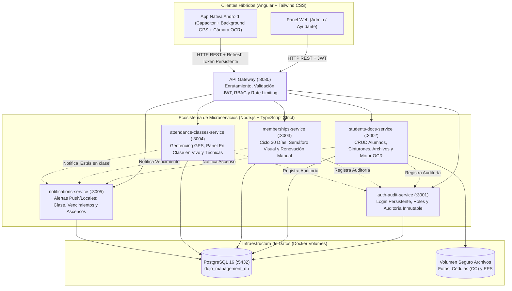

# 🥋 Sistema Híbrido de Gestión de Dojo (Web + Android App con Capacitor)

Plataforma integral de misión crítica para la administración de un Dojo de artes marciales. Construida bajo una **Arquitectura de Microservicios** en TypeScript estricto (`strict: true`), base de datos **PostgreSQL** contenedorizada, reconocimiento óptico de caracteres (**OCR**) para Cédula de Ciudadanía y EPS, control de mensualidades con **semáforo visual sin auto-renovación**, **auditoría inmutable** y **Geofencing GPS en segundo plano** para dispositivos Android mediante **Angular + Tailwind CSS + Capacitor**.

---

## 📐 1. Reglas de Ingeniería y Calidad Aplicadas

1. **Modularidad Estricta (< 300 líneas por archivo):** Ningún archivo fuente (`.ts`, `.html`, `.css`, `.sql`, `Dockerfile`, `.yml`) supera las 300 líneas.
2. **Tipado Estricto (`strict: true`):** Prohibido el uso de `any` en todos los microservicios y en el cliente Angular.
3. **Código 100% Documentado en Español:** JSDoc en clases, interfaces, controladores, middlewares y lógica de negocio.
4. **Bitácora de Auditoría Inmutable (`audit_logs`):** Protegida mediante trigger de PostgreSQL contra `UPDATE` o `DELETE`, registrando usuario (`user_id`, nombre, rol), tabla afectada, fecha/hora y `old_data` vs `new_data`.

---

## 🏗️ 2. Arquitectura del Sistema y Diagrama de Microservicios



---

## 📁 3. Estructura Completa del Monorepo

```text
DOJO/
├── .env.example                           # Plantilla documentada de variables de entorno
├── docker-compose.yml                     # Orquestador de PostgreSQL, 6 microservicios y Frontend
├── README.md                              # Guía maestra de arquitectura, despliegue y compilación APK
├── database/
│   └── init/                              # Scripts SQL ejecutados automáticamente al iniciar Postgres
│       ├── 01_schema_core.sql             # Tablas: users, refresh_tokens, belts, students, promotions, docs
│       └── 02_schema_operations_seed.sql  # Tablas: memberships, attendance, notifications, audit_logs y seeds
├── services/
│   ├── api-gateway/                       # (:8080) Proxy inverso, validación JWT, RBAC y Rate Limiter
│   │   ├── Dockerfile
│   │   ├── package.json
│   │   ├── tsconfig.json
│   │   └── src/
│   │       ├── index.ts
│   │       ├── config/env.config.ts
│   │       ├── middlewares/auth-rbac.middleware.ts
│   │       └── routes/gateway.routes.ts
│   ├── auth-audit-service/                # (:3001) Login persistente, gestión de roles y audit_logs
│   │   ├── Dockerfile
│   │   ├── package.json
│   │   ├── tsconfig.json
│   │   └── src/
│   │       ├── index.ts
│   │       ├── db/pool.ts
│   │       ├── types/auth.types.ts
│   │       ├── services/auth.service.ts
│   │       ├── services/audit.service.ts
│   │       ├── controllers/auth.controller.ts
│   │       └── routes/auth.routes.ts
│   ├── students-docs-service/             # (:3002) Alumnos, cinturones, subida de CC/EPS y OCR Tesseract
│   │   ├── Dockerfile
│   │   ├── package.json
│   │   ├── tsconfig.json
│   │   └── src/
│   │       ├── index.ts
│   │       ├── db/pool.ts
│   │       ├── types/student.types.ts
│   │       ├── services/ocr.service.ts
│   │       ├── services/students.service.ts
│   │       ├── controllers/students.controller.ts
│   │       └── routes/students.routes.ts
│   ├── memberships-service/               # (:3003) Semáforo (Verde/Amarillo/Rojo) y renovación manual ADMIN
│   │   ├── Dockerfile
│   │   ├── package.json
│   │   ├── tsconfig.json
│   │   └── src/
│   │       ├── index.ts
│   │       ├── db/pool.ts
│   │       ├── types/membership.types.ts
│   │       ├── services/memberships.service.ts
│   │       ├── controllers/memberships.controller.ts
│   │       └── routes/memberships.routes.ts
│   ├── attendance-classes-service/        # (:3004) Geofencing Android, "En clase ahora" y bitácora técnica
│   │   ├── Dockerfile
│   │   ├── package.json
│   │   ├── tsconfig.json
│   │   └── src/
│   │       ├── index.ts
│   │       ├── db/pool.ts
│   │       ├── types/attendance.types.ts
│   │       ├── utils/geofence.util.ts
│   │       ├── services/attendance.service.ts
│   │       ├── controllers/attendance.controller.ts
│   │       └── routes/attendance.routes.ts
│   └── notifications-service/             # (:3005) Notificaciones Push y Locales para Android y Web
│       ├── Dockerfile
│       ├── package.json
│       ├── tsconfig.json
│       └── src/
│           ├── index.ts
│           ├── db/pool.ts
│           ├── types/notification.types.ts
│           ├── services/notifications.service.ts
│           ├── controllers/notifications.controller.ts
│           └── routes/notifications.routes.ts
└── frontend/                              # Aplicación Híbrida Angular Standalone + Tailwind + Capacitor
    ├── Dockerfile
    ├── nginx.conf
    ├── package.json
    ├── capacitor.config.ts                # Configuración nativa Android (permisos GPS, Cámara y Push)
    ├── tailwind.config.js
    ├── tsconfig.json
    └── src/
        ├── index.html
        ├── main.ts
        ├── styles.css
        └── app/
            ├── app.component.ts
            ├── app.routes.ts
            ├── core/
            │   ├── models/dojo.models.ts
            │   ├── services/auth-session.service.ts
            │   ├── services/dojo-api.service.ts
            │   ├── services/native-geofence.service.ts
            │   └── guards/role.guard.ts
            └── features/
                ├── auth/login.component.ts
                ├── admin/
                │   ├── admin-dashboard.component.ts
                │   ├── student-ocr-form.component.ts
                │   └── audit-viewer.component.ts
                ├── assistant/
                │   └── assistant-class-log.component.ts
                └── student/
                    └── student-mobile-home.component.ts
```

---

## 🚀 4. Guía Paso a Paso: Instalación y Puesta en Marcha

### Paso 1: Clonar el repositorio y configurar variables de entorno

```bash
# 1. Ubicarse en la carpeta del proyecto
cd DOJO

# 2. Crear el archivo .env a partir de la plantilla .env.example
cp .env.example .env
```

> **Nota sobre Geofencing:** En el archivo `.env`, ajusta las variables `DOJO_GPS_LATITUDE` y `DOJO_GPS_LONGITUDE` con las coordenadas reales del tatami/sede física de tu Dojo, y `DOJO_GEOFENCE_RADIUS_METERS=50` (radio en metros).

### Paso 2: Levantar la Base de Datos PostgreSQL en Docker y ejecutar migraciones

El contenedor `dojo-postgres` monta automáticamente la carpeta `./database/init` dentro de `/docker-entrypoint-initdb.d`. Al iniciar por primera vez, ejecuta en orden:
1. `01_schema_core.sql`: Crea extensiones (`pgcrypto`), enums, tablas de usuarios, tokens persistentes, catálogo de cinturones, estudiantes, ascensos y documentos con JSON de OCR.
2. `02_schema_operations_seed.sql`: Crea tablas de mensualidades (con restricción `CHECK (auto_renew_allowed = FALSE)`), sesiones de asistencia por GPS, notificaciones, la tabla `audit_logs` con su trigger de inmutabilidad, la vista del semáforo `vw_student_membership_traffic_light` y los datos semilla.

```bash
# Levantar únicamente la base de datos primero para verificar su inicialización
docker compose up -d dojo-postgres

# Verificar los logs de creación de tablas y datos semilla
docker logs -f dojo-postgres
```

Para conectarte manualmente a la base de datos y verificar las tablas creadas:

```bash
docker exec -it dojo-postgres psql -U dojo_admin -d dojo_management_db -c "\dt"
```

### Paso 3: Credenciales de Usuarios Iniciales por Defecto (Seeds)

La base de datos se inicializa con **7 cinturones oficiales** (Blanco a Negro 1er Dan) y **3 usuarios listos para probar cada rol**:

| Rol en el Sistema | Usuario / Cédula (`username`) | Contraseña por Defecto | Permisos Principales |
| :--- | :--- | :--- | :--- |
| **`ADMIN`** | `admin` | `AdminDojo2026!` | Control total, OCR de Cédula/EPS, ascensos de cinturón, confirmación manual de pagos, edición en vivo de quién está en clase y visor de auditoría. |
| **`AYUDANTE`** | `ayudante` | `AyudanteDojo2026!` | Solo lectura de fichas de estudiantes (datos básicos, RH, emergencia, cinturón, semáforo) y registro de técnicas/actividades realizadas en cada clase. |
| **`ESTUDIANTE`** | `1020304050` | `EstudianteDojo2026!` | Login persistente en App Android, vista de su cinturón, historial de clases, semáforo de mensualidad y Geofencing automático en segundo plano. |

### Paso 4: Levantar Todo el Ecosistema de Microservicios y Frontend Web

```bash
# Compilar y levantar todos los microservicios, el API Gateway y la aplicación Web
docker compose up --build -d

# Verificar el estado de todos los contenedores
docker compose ps
```

- **Frontend Web:** `http://localhost:4200`
- **API Gateway (Healthcheck & Endpoints):** `http://localhost:8080/api/health`

---

## 📱 5. Compilación de la App Web y Empaquetado del APK de Android con Capacitor

### Requisitos Previos para Compilar el APK
- **Node.js 20+** y **npm**
- **Java JDK 17** configurado en `JAVA_HOME`
- **Android Studio / Android SDK** configurado en `ANDROID_HOME`

### Paso a Paso para Generar el APK Nativo

```bash
# 1. Entrar al directorio del frontend híbrido
cd frontend

# 2. Instalar dependencias de Angular, Tailwind CSS y Capacitor
npm install

# 3. Compilar la aplicación Angular en modo producción (genera carpeta dist/dojo-app)
npm run build

# 4. Inicializar o agregar la plataforma Android de Capacitor (primera vez)
npx cap add android

# 5. Sincronizar el código web compilado y los plugins nativos (Geolocation, Camera, LocalNotifications)
npx cap sync android
```

### Permisos Nativos en `AndroidManifest.xml`
El proyecto configura automáticamente en `android/app/src/main/AndroidManifest.xml` los permisos requeridos para el funcionamiento del Dojo:
- `android.permission.ACCESS_FINE_LOCATION` y `android.permission.ACCESS_COARSE_LOCATION`
- `android.permission.ACCESS_BACKGROUND_LOCATION` (*"Permitir todo el tiempo"* para detectar permanencia en el Dojo sin abrir la app)
- `android.permission.FOREGROUND_SERVICE` y `android.permission.FOREGROUND_SERVICE_LOCATION`
- `android.permission.CAMERA` (para escanear Cédula y certificado de EPS con OCR)
- `android.permission.POST_NOTIFICATIONS` (para alertas de *"Estás en clase"* y vencimiento de mensualidad)

### Generar el Archivo `.apk` Instalable

```bash
# Opción A: Abrir en Android Studio para firmar o depurar en un teléfono físico por USB
npx cap open android

# Opción B: Compilar el APK directamente desde terminal usando Gradle
cd android
./gradlew assembleDebug
```

El archivo APK listo para instalar en los teléfonos Android de los estudiantes y senseis se generará en:
`frontend/android/app/build/outputs/apk/debug/app-debug.apk`
